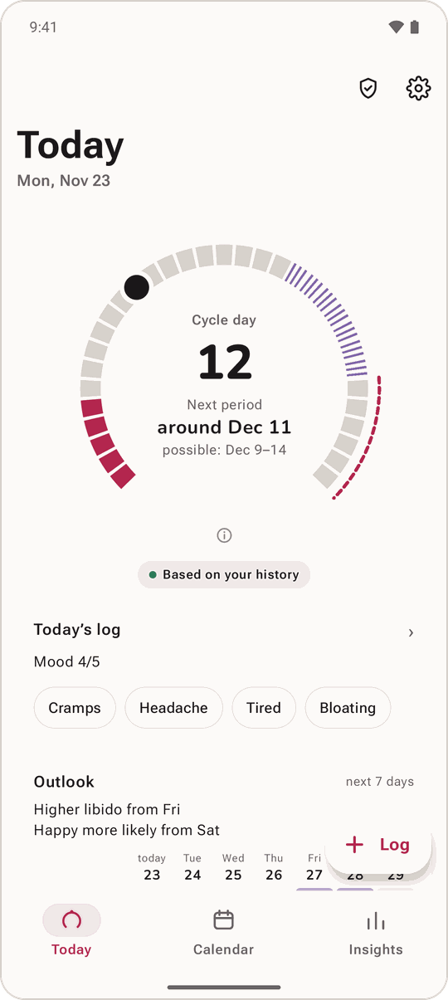
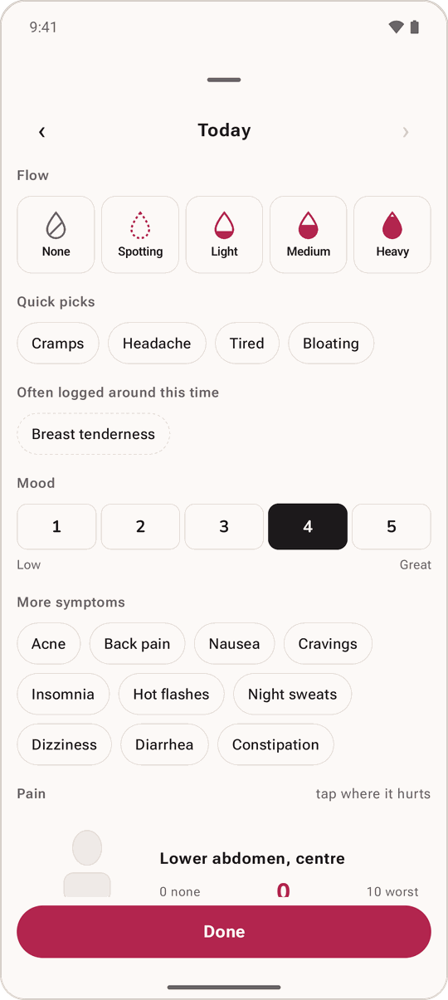
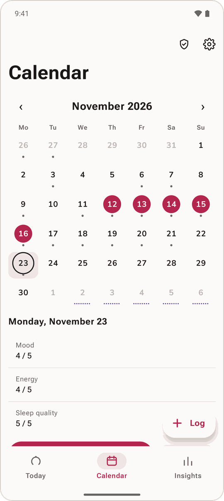
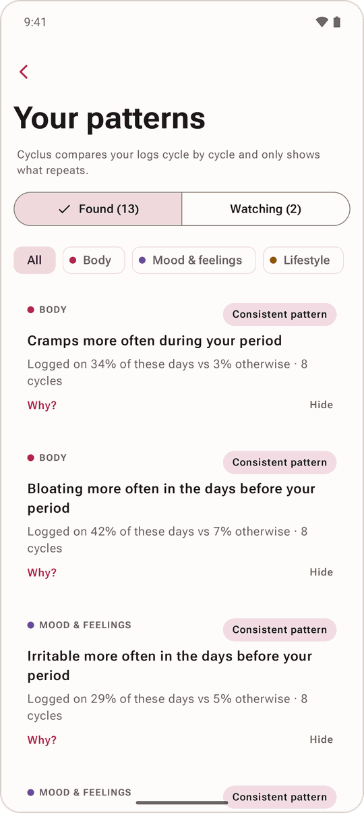
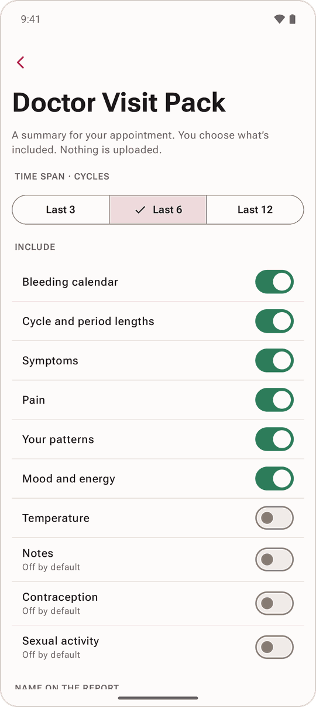
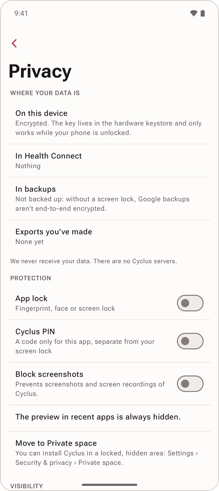

<p align="center">
  
</p>

<h1 align="center">Cyclus</h1>

<p align="center">
  <strong>Understand your cycle. Private and secure.</strong><br>
  A cycle and symptom diary for Android that keeps everything on your device.
</p>

<p align="center">
  <a href="../../releases/latest">Download</a> ·
  <a href="#features">Features</a> ·
  <a href="#privacy">Privacy</a> ·
  <a href="#for-developers">For developers</a>
</p>

No account, no servers, no tracking: all predictions and insights are calculated on your phone, and the app has no
internet access at all. Available in German and English.

<table>
  <tr>
    <td width="33%" valign="top"><br><strong>Today</strong><br><sub>Cycle day, next period and your cards, in the order you choose.</sub></td>
    <td width="33%" valign="top"><br><strong>Log</strong><br><sub>Flow, quick picks, mood and more. Every tap is saved at once.</sub></td>
    <td width="33%" valign="top"><br><strong>Calendar</strong><br><sub>Past periods, the predicted range and each day's entries.</sub></td>
  </tr>
  <tr>
    <td width="33%" valign="top"><br><strong>Your patterns</strong><br><sub>What repeats in your own records, with the evidence behind it.</sub></td>
    <td width="33%" valign="top"><br><strong>Doctor Visit Pack</strong><br><sub>A PDF for your appointment. You choose what goes in.</sub></td>
    <td width="33%" valign="top"><br><strong>Privacy Center</strong><br><sub>Where your data is and how it is protected.</sub></td>
  </tr>
</table>

## Features
- **Today:** a cycle ring with an explanation, your status, today's log, what's coming up and the week at a glance.
  Reorder, hide and add cards to make it yours.
- **Log in seconds:** period, symptoms, feelings, pain, mood and energy, temperature, tags and notes; up to 8 quick
  picks in one tap.
- **Calendar and insights:** your cycle history, typical lengths, patterns found in your own records and a 7-day
  outlook.
- **Trying to conceive:** an optional mode with an estimated fertile window and an LH test plan.
- **Doctor Visit Pack:** a PDF summary for your appointment, in German or English, including your own questions.
- **Your data stays yours:** encrypted backup files you can import again, also on a new phone; Health Connect import
  and optional writing.
- Widgets, a Quick Settings tile, discreet reminders (off until you turn them on), colour themes including Material
  You, dark theme, tablets and foldables.

## Privacy
- Your data is stored encrypted on your device, with the key held by the phone's secure hardware.
- Optional app lock with biometrics or a Cyclus PIN.
- The Privacy Center shows where your data is and lets you erase everything at any time.
- Cyclus never receives your data: there are no Cyclus servers.

## Important
Cyclus is **not for birth control** and is **not a medical device**. Predictions are estimates based on your own
records. For questions or symptoms, talk to your doctor.

## Download
Get the latest APK from [Releases](../../releases/latest). Requires Android 10 or newer.

The release builds are signed with this certificate (SHA-256), so you can check that an APK is genuine:
`9A:2F:7A:A3:C6:13:04:2D:F1:F6:F6:2F:0D:0F:1D:97:66:FB:58:5C:9B:E0:C3:20:62:7A:F2:9E:6D:47:23:56`

An iPhone version is planned on the same shared core.

---

## For developers

Kotlin Multiplatform: the engines, presenters, storage and backup format are shared Kotlin (`shared/`); the Android
app (`androidApp/`) is Jetpack Compose with Material 3 Expressive and is the reference for the planned iOS app.

### Build and test
```sh
./gradlew :shared:jvmTest        # engine tests against the prototype's golden vectors
./gradlew check                  # lint, no-INTERNET check, unit tests
./gradlew :androidApp:assembleRelease   # signed release APK (needs keystore.properties, see below)
./gradlew :androidApp:bundleRelease     # Play bundle (AAB)
tools/deploy.sh                  # debug build: build, install, launch on the emulator
tools/deploy.sh --phone          # same on a phone paired over wireless adb
tools/deploy.sh --phone --optimized   # release code with the debug key, installs over the debug app
ANDROID_SERIAL=emulator-5554 ./gradlew :androidApp:connectedDebugAndroidTest   # UI tests (emulator only)
python3 tools/screens/capture.py # reference screenshots (emulator only)
```
- **Run instrumented tests and the screenshot script only on an emulator:** they erase the app's data.
- **Release signing:** `storeFile`, `storePassword`, `keyAlias`, `keyPassword` in an untracked `keystore.properties`
  (ignored by git, like `*.jks`). Keep the key file outside the repository and backed up: every update must be signed
  with the same key.
- **Strings** come from the prototype's translation table: `node tools/strings/export.mjs`. Golden vectors:
  `node tools/golden/export.mjs`.
- **Debug builds** (`com.nordinary.cyclus.debug`): long-press the screen title "Today" for demo data.
- **Backup format:** [`docs/export/FORMAT.md`](docs/export/FORMAT.md); reference decoder `tools/export/cyclus_decode.py`.

### Documents
| File | What it is |
|---|---|
| [`docs/DESIGN_SPEC.md`](docs/DESIGN_SPEC.md) | Product spec (platform-neutral): decisions, scope, threat model, screens, engines, open questions |
| [`docs/ANDROID_PLAN.md`](docs/ANDROID_PLAN.md) | Android design and implementation |
| [`docs/IOS_PLAN.md`](docs/IOS_PLAN.md) | iOS plan for full parity on the shared core |
| [`docs/PARITY.md`](docs/PARITY.md) | Feature parity matrix (Android/iOS) and allowed platform differences |
| [`docs/screens/`](docs/screens/README.md) | Reference screenshots of every area |
| [`docs/export/FORMAT.md`](docs/export/FORMAT.md) | `.cyclus` backup format (cross-platform), schema, test vectors |
| [`prototype/`](prototype/) | Clickable HTML prototype: visual and copy reference, string source, golden-vector source |
| [`CHANGELOG.md`](CHANGELOG.md) | Release history |
| [`docs/archive/`](docs/archive/) | First plan and its review (history) |

### Troubleshooting
If Gradle reports `Plugin ... was not found` or `Could not find androidx...` although the version exists, Google Maven
may be failing over IPv4 on your network (seen behind a VPN). Run Gradle with IPv6 preferred:
`./gradlew --stop && JAVA_TOOL_OPTIONS=-Djava.net.preferIPv6Addresses=true ./gradlew --refresh-dependencies build`.
The same failure can leave POMs marked missing in Gradle's cache, and the open-source license list in About Cyclus then
silently lacks the AndroidX libraries: `androidApp/build/generated/aboutLibraries/aboutlibraries.json` should list
more than 100 libraries.
