# Reference screenshots

Screens of the **Android app** (the reference implementation), German, light theme unless noted, demo data from the prototype scenarios. Use them next to `prototype/index.html` when building or reviewing another platform (IOS_PLAN §1.2) and for visual parity checks (`PARITY.md`).

Regenerate after UI changes (emulator only — it erases the debug app's data):

```sh
tools/deploy.sh                       # debug build on the emulator
python3 tools/screens/capture.py      # German set → docs/screens/android/
python3 tools/screens/capture.py --lang en   # English set → docs/screens/android-en/
python3 tools/screens/capture.py --only today # one area
```

Dates shown are relative to the capture day (2026-11-23). Images are 640 px wide (50 %), 256-colour PNG.

## Onboarding

<table><tr><td valign="top"><a href="android/01-onboarding-1-welcome.png">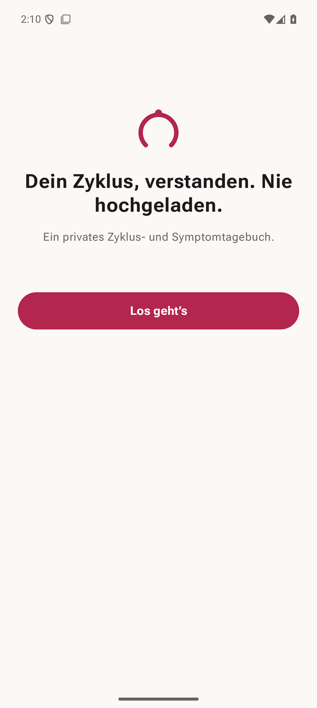</a><br><sub>Welcome</sub></td><td valign="top"><a href="android/01-onboarding-2-privacy.png"></a><br><sub>Privacy promises</sub></td><td valign="top"><a href="android/01-onboarding-3-notice.png"></a><br><sub>„Bevor du startest“ (required consent)</sub></td><td valign="top"><a href="android/01-onboarding-4-import.png">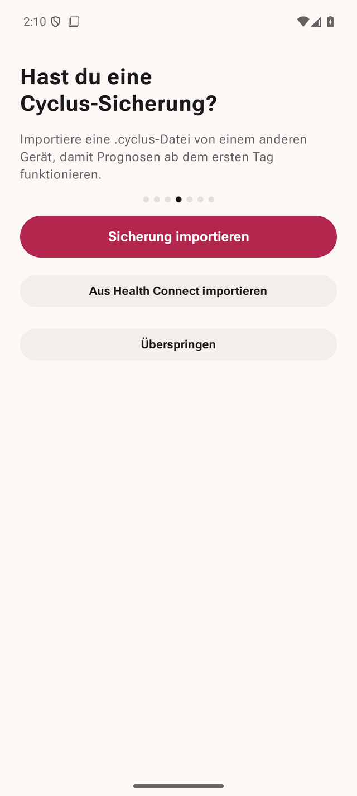</a><br><sub>Import (.cyclus or health store)</sub></td></tr><tr><td valign="top"><a href="android/01-onboarding-5-last-period.png">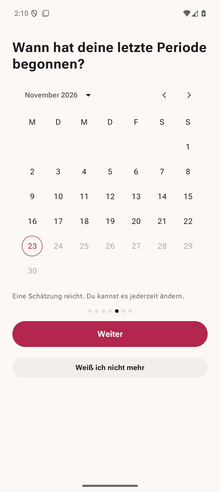</a><br><sub>Last period</sub></td><td valign="top"><a href="android/01-onboarding-6-life-stage.png">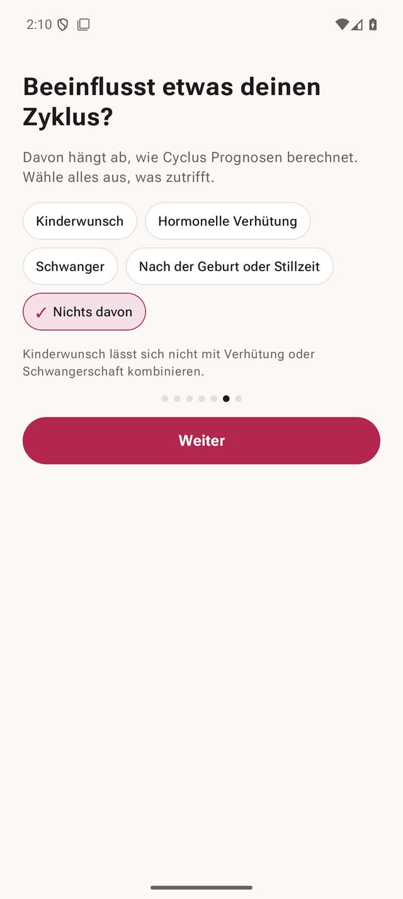</a><br><sub>Life stage / Kinderwunsch</sub></td><td valign="top"><a href="android/01-onboarding-7-app-lock.png">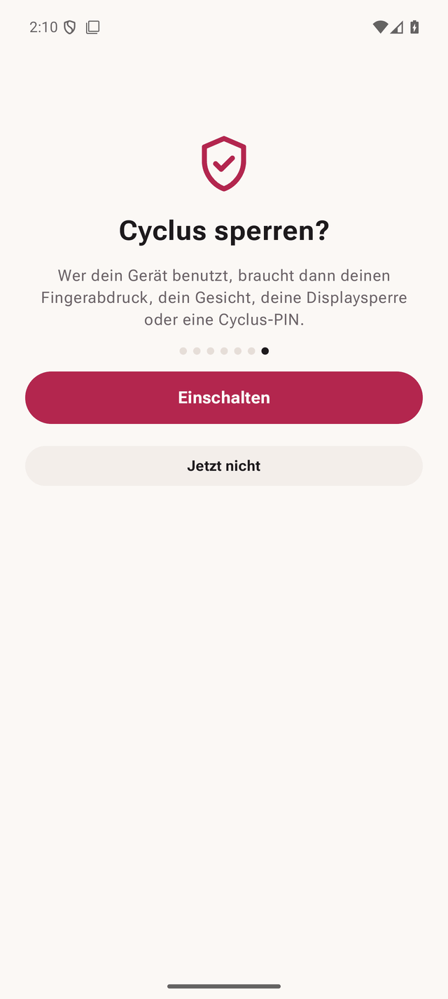</a><br><sub>App lock offer</sub></td></tr></table>

## Today

<table><tr><td valign="top"><a href="android/02-today-empty.png">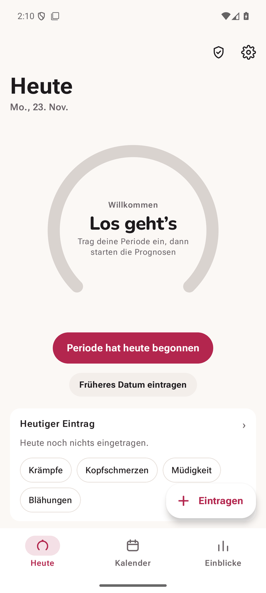</a><br><sub>Today, no data</sub></td><td valign="top"><a href="android/02-today-ring-explainer.png">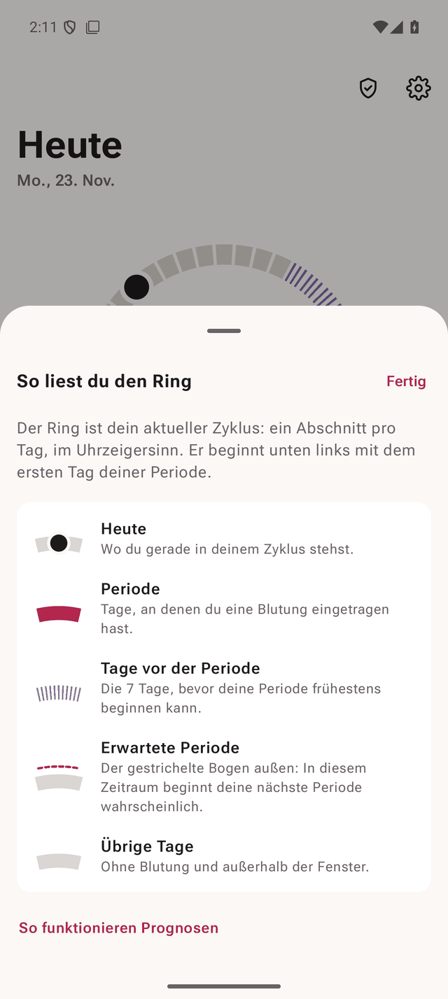</a><br><sub>„So liest du den Ring“</sub></td><td valign="top"><a href="android/02-today-track-1.png">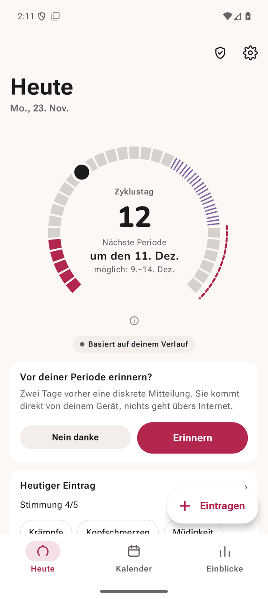</a><br><sub>Today (track), top</sub></td><td valign="top"><a href="android/02-today-track-2.png">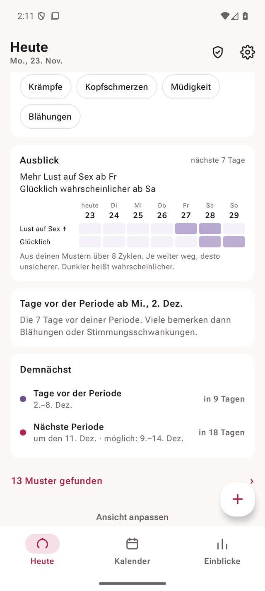</a><br><sub>Today, cards</sub></td></tr><tr><td valign="top"><a href="android/02-today-track-3.png"></a><br><sub>Today, bottom (Demnächst, patterns, Ansicht anpassen)</sub></td></tr></table>

## Customizable Today

<table><tr><td valign="top"><a href="android/03-edit-1.png"></a><br><sub>Edit mode: ring size, cards</sub></td><td valign="top"><a href="android/03-edit-2.png"></a><br><sub>Edit mode: more cards</sub></td><td valign="top"><a href="android/03-edit-3-library.png"></a><br><sub>Edit mode: library + reset</sub></td><td valign="top"><a href="android/03-edit-compact-ring.png">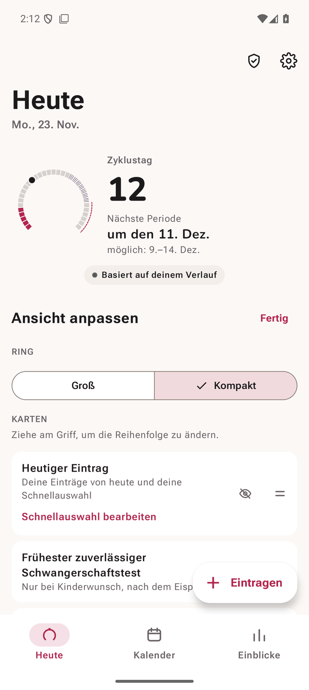</a><br><sub>Edit mode, compact ring</sub></td></tr><tr><td valign="top"><a href="android/03-edit-quick-picks.png">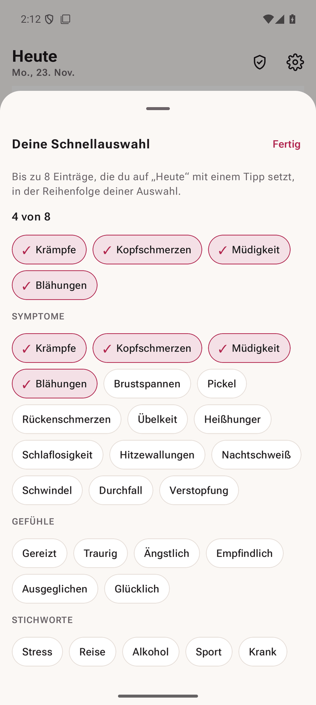</a><br><sub>Deine Schnellauswahl</sub></td><td valign="top"><a href="android/03-today-compact-1.png">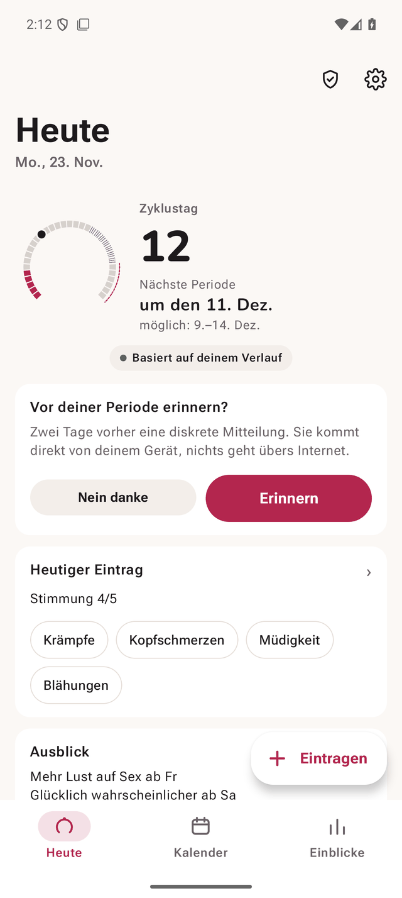</a><br><sub>Today, compact ring</sub></td><td valign="top"><a href="android/03-today-compact-2-week.png"></a><br><sub>Today: Woche card</sub></td></tr></table>

## Log sheet

<table><tr><td valign="top"><a href="android/04-log-1.png"></a><br><sub>Log sheet: flow, quick picks, mood</sub></td><td valign="top"><a href="android/04-log-2.png"></a><br><sub>Log sheet: pain map, feelings, scales</sub></td><td valign="top"><a href="android/04-log-3.png"></a><br><sub>Log sheet: tags, „Sonst nichts heute“</sub></td><td valign="top"><a href="android/04-log-4-more.png">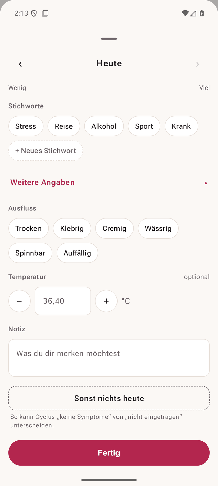</a><br><sub>Log sheet: „Weitere Angaben“ open</sub></td></tr></table>

## Calendar

<table><tr><td valign="top"><a href="android/05-calendar-1.png"></a><br><sub>Calendar</sub></td><td valign="top"><a href="android/05-calendar-2-day.png"></a><br><sub>Calendar: inline day detail</sub></td><td valign="top"><a href="android/05-calendar-3-legend.png">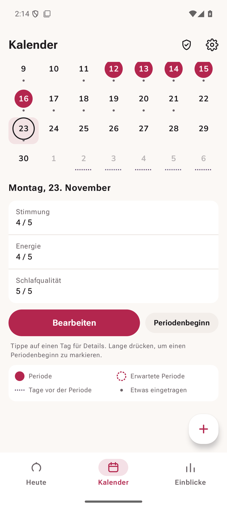</a><br><sub>Calendar: legend</sub></td></tr></table>

## Insights & patterns

<table><tr><td valign="top"><a href="android/06-insights-1.png"></a><br><sub>Insights, top</sub></td><td valign="top"><a href="android/06-insights-2.png"></a><br><sub>Insights: charts</sub></td><td valign="top"><a href="android/06-insights-3.png"></a><br><sub>Insights: heatmap</sub></td><td valign="top"><a href="android/06-insights-4.png"></a><br><sub>Insights: history</sub></td></tr><tr><td valign="top"><a href="android/06-method-sheet.png">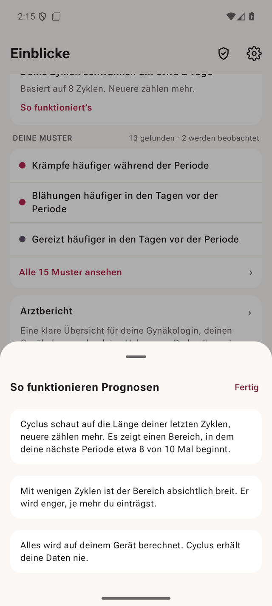</a><br><sub>„So funktionieren Prognosen“</sub></td><td valign="top"><a href="android/06-patterns-1.png"></a><br><sub>Muster screen</sub></td><td valign="top"><a href="android/06-patterns-2.png">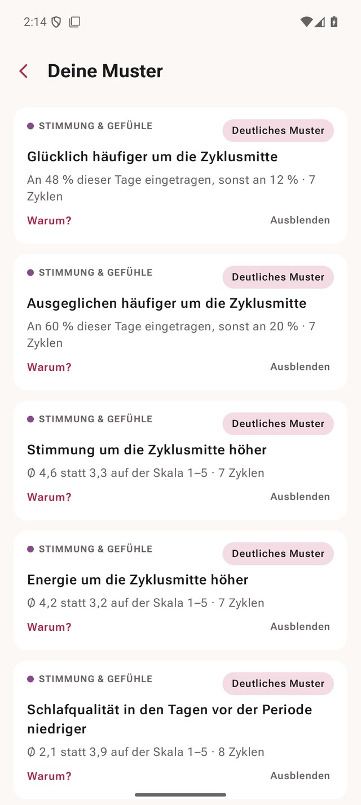</a><br><sub>Muster: cards</sub></td></tr></table>

## Doctor Visit Pack (Arztbericht)

<table><tr><td valign="top"><a href="android/07-report-1.png">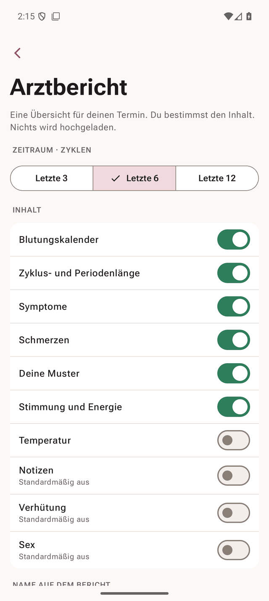</a><br><sub>Arztbericht builder</sub></td><td valign="top"><a href="android/07-report-2.png"></a><br><sub>Arztbericht: sections, questions</sub></td><td valign="top"><a href="android/07-report-3-pdf.png"></a><br><sub>Arztbericht: PDF preview</sub></td><td valign="top"><a href="android/07-report-4-pdf.png"></a><br><sub>Arztbericht: PDF page</sub></td></tr></table>

## Privacy Center

<table><tr><td valign="top"><a href="android/08-privacy-1.png"></a><br><sub>Datenschutz: where your data is</sub></td><td valign="top"><a href="android/08-privacy-2.png">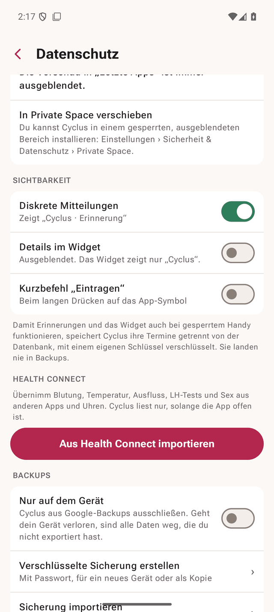</a><br><sub>Datenschutz: protection</sub></td><td valign="top"><a href="android/08-privacy-3.png"></a><br><sub>Datenschutz: visibility, Health Connect</sub></td><td valign="top"><a href="android/08-privacy-4.png"></a><br><sub>Datenschutz: backups, legal, erase</sub></td></tr><tr><td valign="top"><a href="android/08-privacy-erase.png">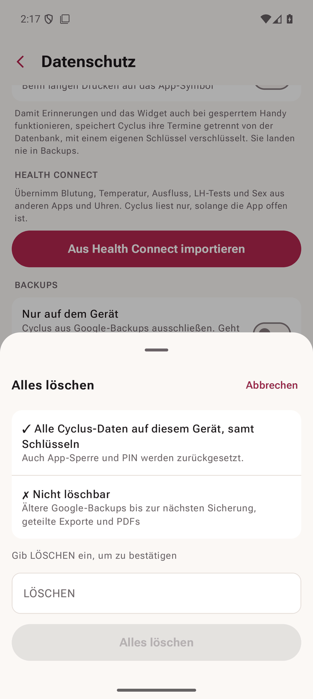</a><br><sub>Alles löschen</sub></td><td valign="top"><a href="android/08-privacy-export.png"></a><br><sub>Encrypted backup (export)</sub></td><td valign="top"><a href="android/08-privacy-notice-history.png"></a><br><sub>Wichtiger Hinweis + confirmations</sub></td></tr></table>

## Settings & notifications

<table><tr><td valign="top"><a href="android/09-notifications.png"></a><br><sub>Mitteilungen</sub></td><td valign="top"><a href="android/09-settings-1.png">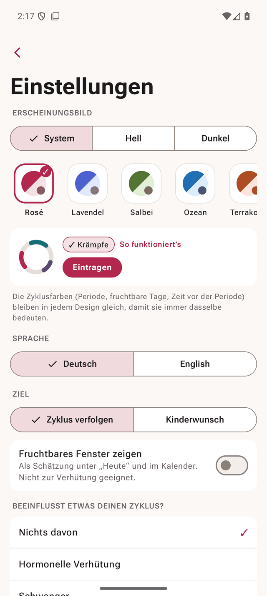</a><br><sub>Settings: appearance</sub></td><td valign="top"><a href="android/09-settings-2.png"></a><br><sub>Settings: language, goal, fertile window</sub></td><td valign="top"><a href="android/09-settings-3.png"></a><br><sub>Settings: life stage, more</sub></td></tr></table>

## App lock

<table><tr><td valign="top"><a href="android/10-lock-pin-setup.png"></a><br><sub>Cyclus-PIN setup</sub></td><td valign="top"><a href="android/10-lock-screen.png">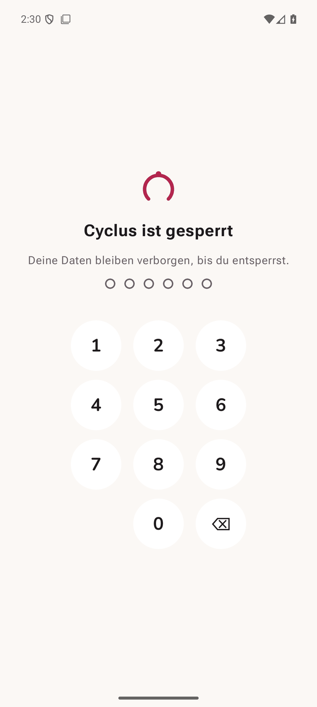</a><br><sub>App lock screen</sub></td></tr></table>

## Today: cycle states

<table><tr><td valign="top"><a href="android/11-today-expected.png"></a><br><sub>Today: period expected</sub></td><td valign="top"><a href="android/11-today-in-period.png">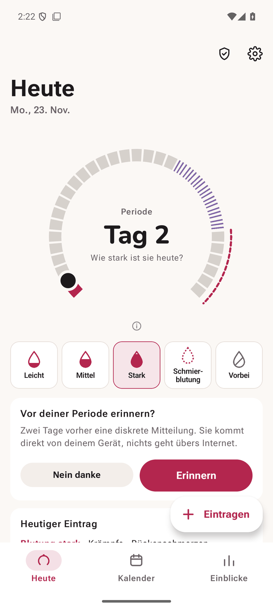</a><br><sub>Today: in period</sub></td><td valign="top"><a href="android/11-today-paused.png">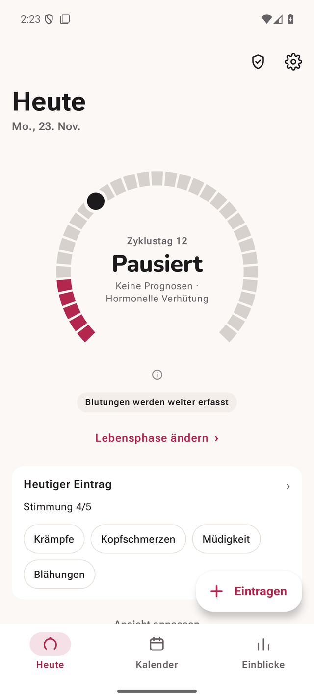</a><br><sub>Today: paused (pill)</sub></td></tr></table>

## Kinderwunsch (conceive mode)

<table><tr><td valign="top"><a href="android/12-conceive-1.png"></a><br><sub>Kinderwunsch: Today</sub></td><td valign="top"><a href="android/12-conceive-2.png"></a><br><sub>Kinderwunsch: cards</sub></td><td valign="top"><a href="android/12-conceive-2ww.png">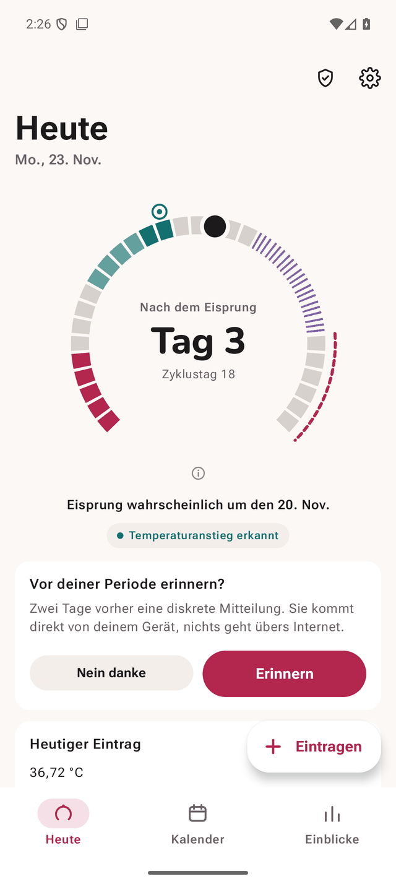</a><br><sub>Kinderwunsch: after ovulation</sub></td><td valign="top"><a href="android/12-conceive-calendar.png">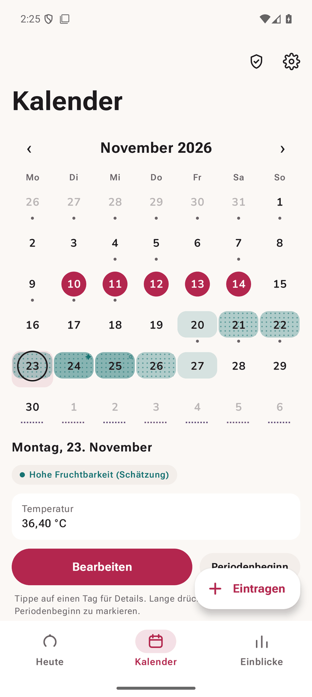</a><br><sub>Kinderwunsch: calendar</sub></td></tr><tr><td valign="top"><a href="android/12-conceive-why-sheet.png">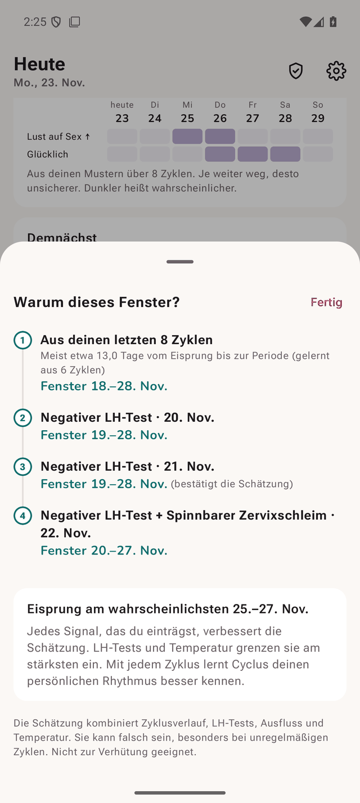</a><br><sub>„Warum dieses Fenster?“</sub></td></tr></table>

## Dark theme

<table><tr><td valign="top"><a href="android/13-dark-calendar.png">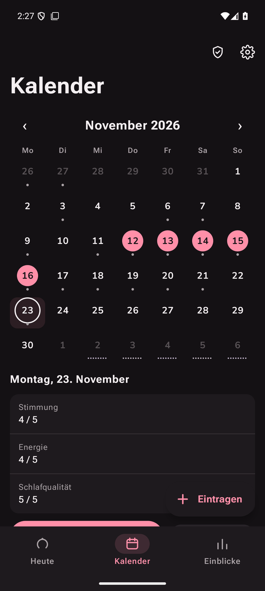</a><br><sub>Dark: Calendar</sub></td><td valign="top"><a href="android/13-dark-insights.png">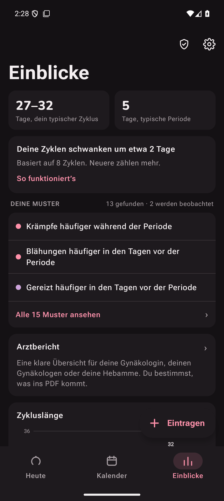</a><br><sub>Dark: Insights</sub></td><td valign="top"><a href="android/13-dark-log.png">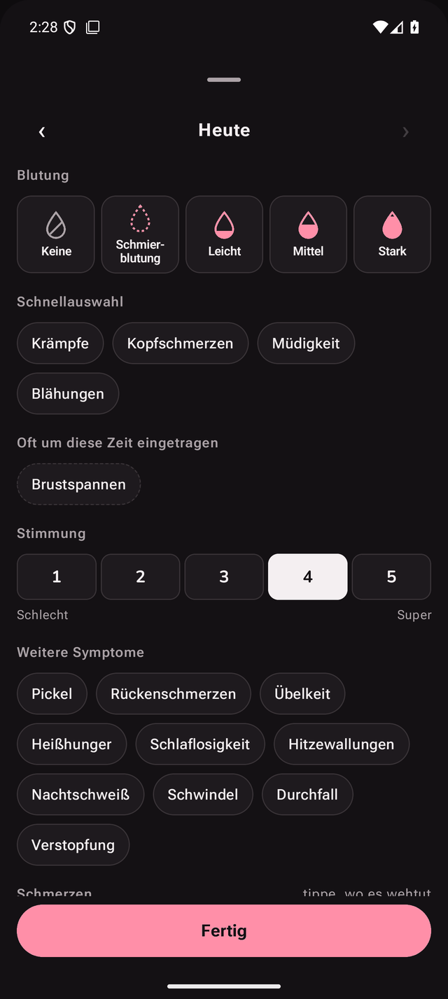</a><br><sub>Dark: Log sheet</sub></td><td valign="top"><a href="android/13-dark-today.png">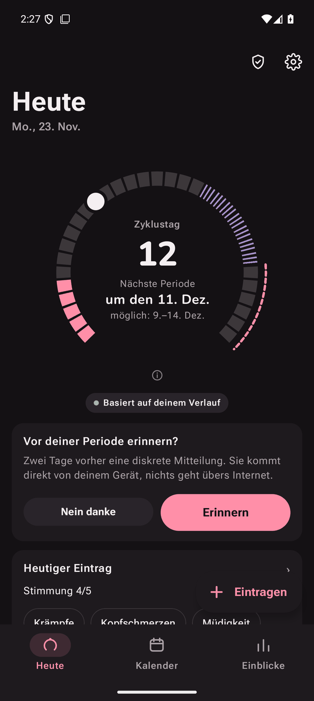</a><br><sub>Dark: Today</sub></td></tr></table>
